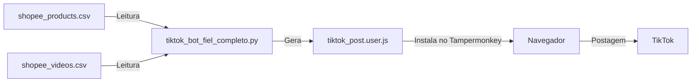

# 🎵 TikTok Post - Gerador de Script Tampermonkey

## O que é?

Gera um script `tiktok_post.user.js` para ser usado no Tampermonkey (navegador) e facilitar a postagem semi-automática de produtos no TikTok.

- Lê os CSVs gerados pelo `shopee_extract_mp4`
- Gera um script Tampermonkey pronto para instalar
- A postagem real acontece no navegador, via Tampermonkey

## Componentes

### 1. tiktok_bot_fiel_completo.py - Gerador do Script

Script Python que lê os CSVs e escreve `tiktok_post.user.js`.

#### Pré-requisitos
```bash
# Python 3.9+
python --version

# Instalar dependências
pip install pandas pillow
```

#### Como usar

```bash
# 1. Navegue até a pasta
# cd /caminho/do/repo/BestPriceToday/tools/tiktok_post

# 2. Garanta que os CSVs do shopee_extract_mp4 estejam na pasta (ou no caminho esperado)
#    shopee_products.csv
#    shopee_videos.csv

# 3. Executar gerador
python tiktok_bot_fiel_completo.py
```

#### Saída
- `tiktok_post.user.js` - Script para Tampermonkey

### 2. tiktok_post.user.js - Tampermonkey Script

Script de navegador que automatiza a postagem no TikTok Studio.

#### Como usar

1. **Instalar Tampermonkey**
   - Chrome: https://chrome.google.com/webstore/detail/tampermonkey
   - Firefox: https://addons.mozilla.org/firefox/addon/tampermonkey

2. **Instalar o script gerado**
   - Abra `tiktok_post.user.js` no editor
   - Copie todo o conteúdo
   - Crie novo script no Tampermonkey e cole

3. **Usar**
   - Acesse o TikTok Studio no navegador
   - Execute o script via Tampermonkey
   - Siga as instruções exibidas na página

## Fluxo de Trabalho



## Arquivos

| Arquivo | Descrição |
|---------|-----------|
| `tiktok_bot_fiel_completo.py` | Gera o script Tampermonkey |
| `tiktok_post.user.js` | Script de postagem (gerado) |

## Exemplo de Execução

```bash
# 1. Extrair produtos do Shopee
cd ../shopee_extract_mp4
# ... execute console_script.js no navegador ...

# 2. Gerar o script Tampermonkey
cd ../tiktok_post
python tiktok_bot_fiel_completo.py

# 3. Instalar tiktok_post.user.js no Tampermonkey e usar no TikTok Studio
```

## Dicas

- ✅ Use contas de teste primeiro
- ✅ Respeite o rate limit do TikTok
- ✅ Varie os horários de postagem
- ✅ Monitore os vídeos para engajamento
- ⚠️ Leia os termos de uso do TikTok
- ⚠️ Não use automação excessivamente (pode resultar em ban)
- ⚠️ Mantenha conteúdo de qualidade

## Troubleshooting

| Problema | Solução |
|----------|--------|
| Script não gera | Verifique se `shopee_products.csv` e `shopee_videos.csv` existem |
| Tampermonkey não executa | Verifique se o script está ativo e a URL do TikTok Studio está correta |
| TikTok atualizou interface | Edite os seletores CSS no script gerado |

## Integração com Shopee Extract

```bash
# Fluxo completo
cd ../shopee_extract_mp4
# ... extrair produtos com console_script.js ...

cd ../tiktok_post
python tiktok_bot_fiel_completo.py
# Instale o tiktok_post.user.js gerado no Tampermonkey
```

---

**Última atualização:** 1 de julho de 2026
